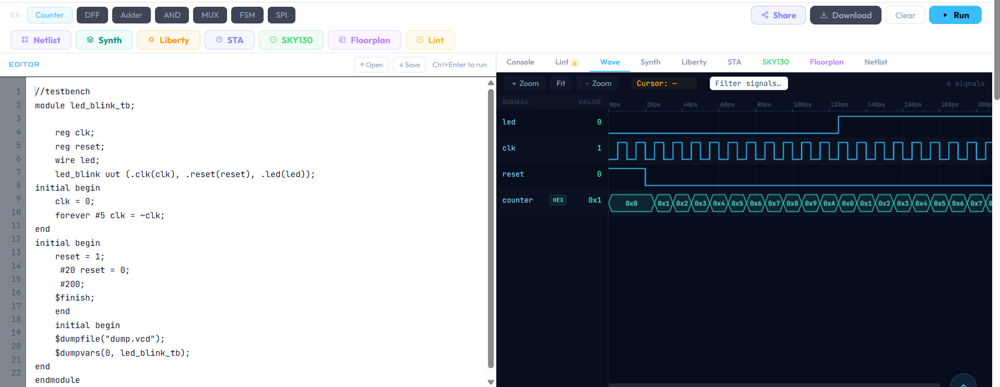
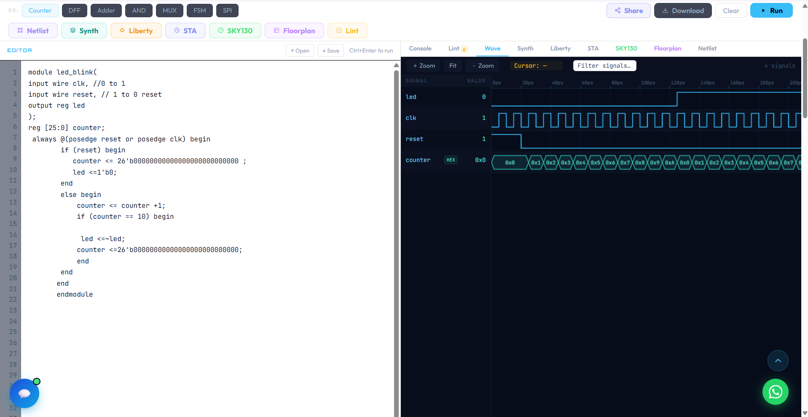
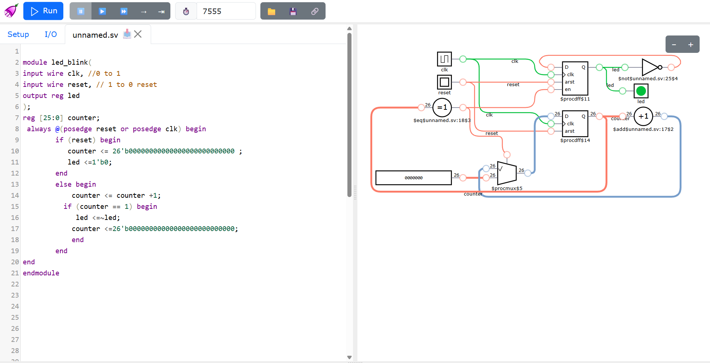

# LED Blink: Verilog Sequential Design

This is my first sequential circuit in Verilog, an LED blinker built from a clock divider and a counter. I built it while learning digital design from scratch, and it's the project where sequential logic finally clicked for me.

## What it does

The circuit counts clock ticks with a 26-bit counter. When the count reaches a target, the LED flips (on to off, or off to on) and the counter starts again. That repeating flip is the blink.

There's also a reset input, so the circuit always starts from a known state.

## Note on the target value

In the simulation I set the target to 10 so the blink is easy to see in a waveform. On a real 50 MHz clock you'd use about 50,000,000 for a blink of roughly one second. That's why the counter is 26 bits wide. In the DigitalJS demo I lowered it to 1 so the LED toggles faster.

## Files

- `led_blink.v` is the design
- `led_blink_tb.v` is the testbench. It makes the clock, applies reset, and runs the simulation.

## How I checked it

I checked it two ways.

1. **Waveform:** I watched the counter climb and the LED toggle at the target.
2. **Circuit view in DigitalJS:** I stepped through it click by click and watched the LED change.

## What I learned

Why sequential logic needs a clock, why blocking and non-blocking assignments aren't interchangeable, and how to size a counter from the number you need to reach. The biggest lesson was that understanding why each line exists matters more than memorizing syntax.
