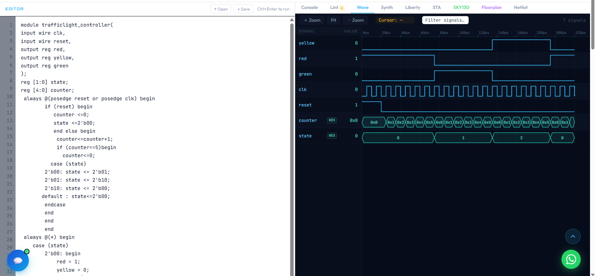

# Traffic Light Controller: Verilog FSM

A traffic light that cycles Red, Green, Yellow and back to Red, built as a finite state machine in Verilog. It's my second project, after the LED blinker. The new idea here was states: the circuit remembers which light it's on and decides what comes next.

## How it works

The design has two parts that work together.

1. **State logic (clocked).** A 2-bit `state` register holds the current light. A counter counts clock ticks, and when it reaches the target the state moves to the next one. Reset always puts it back to Red.
2. **Output logic (combinational).** A second block reads `state` and turns on exactly one of `red`, `yellow` or `green`. It has no clock, so the lights change the moment `state` changes.

| State | Light |
|-------|-------|
| 00 | Red |
| 01 | Green |
| 10 | Yellow |

Sequence: Red, Green, Yellow, Red.

## Note on timing

In simulation each light stays on for 6 clock cycles so the whole cycle fits in a short waveform. A real traffic light would use a much larger count, the same way the LED blinker needs a large target on a real clock.

## Files

- `trafficlight_controller.v` is the design
- `trafficlight_controller_tb.v` is the testbench. It makes the clock, applies reset and runs one full cycle.

## How I checked it

I ran the testbench in EcrioniX and read the waveform. The `state` signal steps through 0, 1, 2 and back to 0, and each time it changes, the matching light turns on and the other two turn off.

## What I learned

- Why an FSM keeps its state transitions and its outputs in separate blocks.
- How to use a `case` statement for both transitions and outputs.
- My first waveform showed the wrong light for one state. I had swapped the outputs for Green and Yellow, and I only noticed because I compared the waveform against the sequence I planned. Reading a waveform critically caught a bug that "it compiled" never would have.
