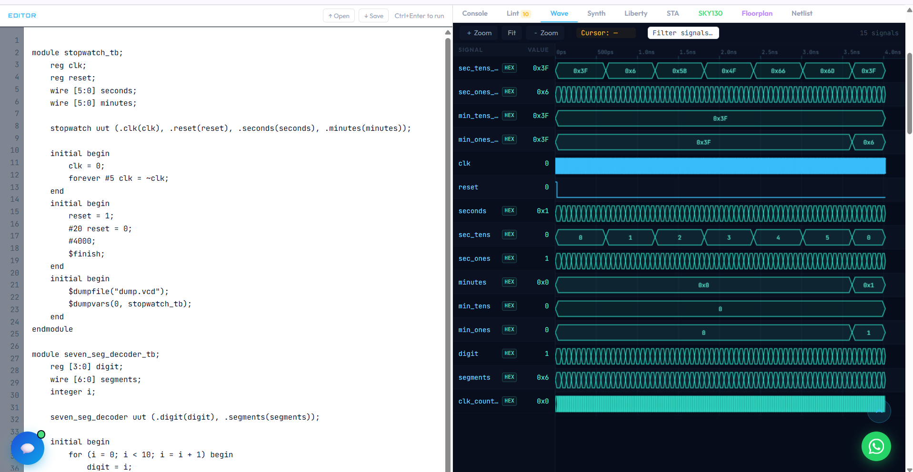
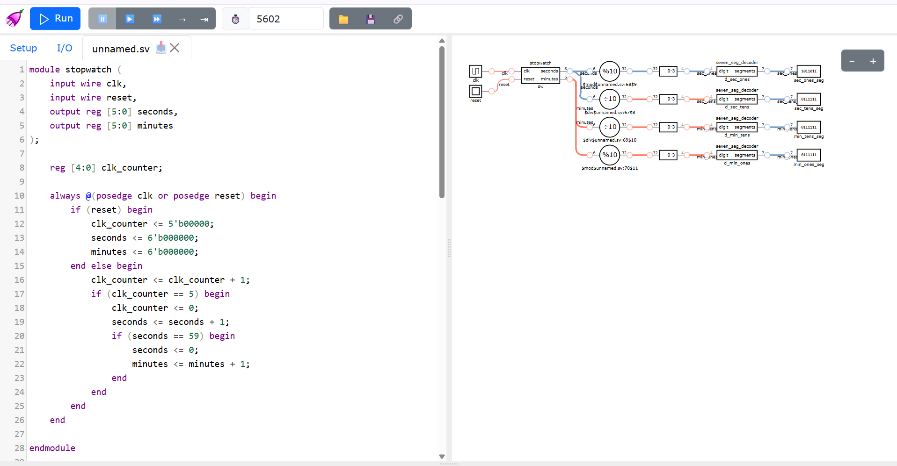

# Stopwatch using 7-Segment Decoder

A minutes and seconds stopwatch in Verilog. Its outputs are turned into the 7-segment patterns that would drive four display digits. This is my third project. The new ideas were nested counters, splitting a number into digits, and connecting several modules together.

## How it works

The project has three modules.

1. **stopwatch**: a small counter counts clock ticks. Every time it reaches the target, `seconds` goes up by 1. When `seconds` reaches 59 it goes back to 0 and `minutes` goes up by 1.
2. **seven_seg_decoder**: takes one digit (0 to 9) and outputs 7 bits, one for each segment of a display. A 1 means the segment is on. The bit order is g, f, e, d, c, b, a.
3. **stopwatch_display**: the top module. It splits `seconds` and `minutes` into tens and ones digits with `/` and `%`, then sends each digit through its own copy of the decoder. That gives four outputs: minutes tens, minutes ones, seconds tens and seconds ones.

## Note on timing

In simulation one "second" is 6 clock cycles, so the waveform stays short. A real clock would need a much larger count, the same idea as in the LED blinker.

## Files

- `stopwatch.v` and `stopwatch_tb.v`
- `seven_seg_decoder.v` and `seven_seg_decoder_tb.v`
- `stopwatch_display.v` and `stopwatch_display_tb.v`

## How I checked it

- **Decoder:** the testbench feeds in digits 0 to 9 and prints the 7-bit pattern for each. It also tests digit 12, which is not valid, and the segments all turn off.
- **Full system waveform:** I read the `seconds`, `sec_tens` and `sec_ones` signals together with the decoder outputs. The tens digit changes when seconds go from 9 to 10, and the minutes digit changes after 59 seconds.

- **Circuit view in DigitalJS:** I stepped through the circuit and read the four outputs. This tool shows the segment patterns as numbers, not as drawn digits. For example, 102 is the pattern for a 4.

## What I learned

How to split a number into digits, how one module can be reused several times, and how modules connect through a top module. I also learned to read a pattern like 1100110 and know which digit it is.
